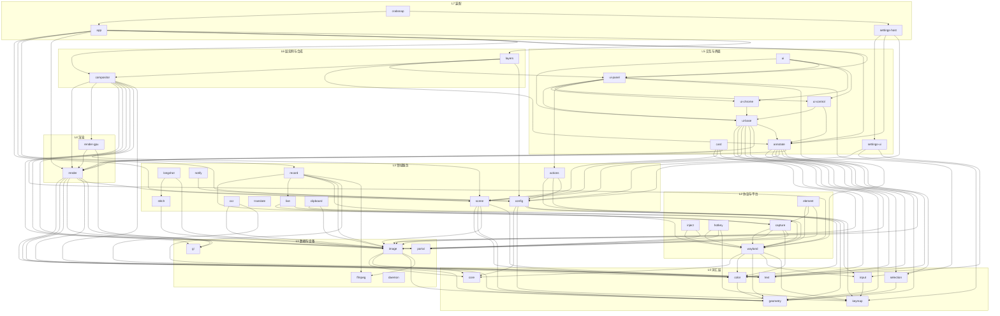

# CrabSnap NG —— 目标架构设计

> 状态：**设计定稿待评审**（本目录尚无代码）
> 对象：`/home/ollie/git/crabsnap`（下文称「旧项目」）
> 产出：`/home/ollie/git/crabsnap-ng`（下文称「新项目」）
> 版本：设计基线 v1，2026-10-25

---

## 0. 摘要

| 项 | 旧项目 | 新项目 |
|---|---|---|
| 形态 | 单 package + workspace 里 1 个子 crate | **虚拟 workspace + 43 个 crate + `xtask`** |
| 顶层模块 | 28 个，其中 **26 个同处一个依赖 SCC** | 无环；依赖方向由 `xtask arch` 强制 |
| 代码量 | 142k 行（`src/` + `crates/settings/src`） | 同量搬迁，逻辑不变 |
| 调试信息 | `[profile.dev] debug = false, opt-level = 1` | **逐字一致**，且只存在于 workspace 根 |
| 主二进制链接的 UI 框架 | 主二进制链接 `eframe`/`egui`/`winit`（设置窗口宿主在 `app/cli/commands/settings`） | 主二进制**不链接**任何 egui/eframe；设置窗口独立二进制 |
| 主二进制链接的渲染后端 | 恒链接 GPU 与 CPU 两个后端 | GPU 后端是可关的 crate（`--no-default-features` 即纯 CPU 构建） |
| 编译期 cfg | `crabsnap_egl` / `crabsnap_gbm` 被 6 个模块消费 | 不跨 crate；GL 改运行时探测，FFmpeg/录制 cfg 收进各自 crate |
| 测试 | 622 个 `#[test]`，257 个 `#[cfg(test)]` 模块 | **不追求数量对齐**：按 AGENTS.md §7 逐条审——原子、可证伪、无 IO 的保留；凑数/跨模块/快照的删除。数量会下降，这是预期 |

**核心结论：这次重构的难点不是切文件，而是拆环。** 旧项目的 28 个顶层模块里有 26 个
互相依赖成环（即使把 `//`/`///` 注释里的文档链接全部剔除，仍有 24 个同处一个 SCC）。
所以迁移顺序被严格约束为：**先改依赖方向（Phase 1，仍是单 crate、行为不变）→ 再切 crate
（Phase 2–7，每步可编译可测）**。任何「先切目录再修编译」的做法都会在第 3 个 crate 处
陷入互指。

---

## 1. 目标与非目标

### 1.1 目标

1. **依赖方向可验证**：每个 crate 的依赖集合是一条**显式白名单**（`arch.toml`），
   由 `cargo xtask arch` 在 CI 里强制；新增反向依赖会直接构建失败，而不是靠 code review。
2. **磁盘与构建时间**：cargo profile 与旧项目完全一致（`debug = false`、`opt-level = 1`、
   test 档保留 `debug-assertions`），并在此基础上减少主二进制的链接面
   （去掉 egui/eframe/winit，GPU 后端可裁剪）。
3. **职责单一**：一个 crate 一句话能说清它是什么；说不清的说明该拆或该合。
4. **可独立测试**：低层 crate（`core`/`color`/`image`/`scene`/`render`）不依赖 Wayland，
   单测无需连 compositor（旧项目已有这条纪律，新项目让它**结构上不可能违反**）。
5. **单进程语义不变**：所有 crate 都是 `rlib`，静态链接进**一个** `crabsnap` 二进制；
   「一个进程、一个 output、一个 `wl_surface`、一次 commit」不因拆分而改变。
6. **迁移可回滚**：每个 Phase 结束都是一个可编译、测试全绿的提交点。

### 1.2 非目标

- 不改任何用户可见行为（CLI、配置、输出、观感）。
- 不换依赖版本（33 个外部依赖的版本与 feature 逐字沿用旧 `Cargo.toml`；只新增
  `libloading`，见 ADR-007）。
- 不做跨平台抽象（`platform/windows` 仍不立项；但 `wayland`/`capture`/`inject`/`hotkey`/
  `element` 已经按「可平行替换」的形状切开）。
- 不重写算法、不顺手优化热点（性能改动混进重构会让「测试变红」无法归因）。
- 不发布到 crates.io（全部 `publish = false`）。

---

## 2. 现状诊断（为什么不能按目录切）

### 2.1 模块依赖的真实形状

对 `src/` 做「按顶层模块聚合的 `crate::x` 引用」统计（剔除 `//`、`///`、`/* */` 注释，
即只看会参与编译的路径）：

```
annotate → core, image, render, scene, selection, text, ui-chrome
app      → 其余几乎全部（含 geometry 23 处、selection 1 处）
render   → core(283) image(122) scene(187) gl(13) layer(3) layers(1) ui(1)
layer    → render(98) core(82) scene(39) image(24) platform(27) gl(16) layers(11) ui(17)
ui       → annotate(56) scene(122) image(91) core(44) platform(38) render(18) input(20)
platform → app(17) core(62) image(10) input(4) longshot(7) record(1) clipboard(1) settings(2)
model    → core(68) ffmpeg(18)
core     → platform(1)          ← 唯一一条，但足以把 L0 拖进整个环
```

Tarjan 求强连通分量（只看代码引用）：

```
SCC #1 (24 个模块)：annotate app card clipboard core ffmpeg gl input layer layers live
                    longshot model notify ocr platform record render scene selection
                    settings stitch translate ui
SCC #2..#5 (各 1 个)：paths select text parallel
```

**只要这 24 个还在一个 SCC 里，就不存在任何一种 crate 划分**——crate 图必须是 DAG。
所以 Phase 1 的唯一目标是把 SCC 拆成 DAG，且这一步不改变任何行为。

### 2.2 15 处反向依赖（拆环清单摘要）

完整清单（含 `file:line`、动作、影响面、验证方式）见
[`docs/migration.md` §2](migration.md)。摘要：

| # | 反向依赖 | 证据 | 动作 |
|---|---|---|---|
| 1 | `core::color` → `platform::wayland::color_proto` | `src/core/color/output.rs:17` | `OutputColour` 下沉到 `crabsnap-color`，协议层填它 |
| 2 | `gl::context` → `render`/`scene`/`image` | `src/gl/context.rs:334-345` | 渲染自检函数搬到 `crabsnap-render-gpu::selftest`，`gl` 只暴露探测钩子 |
| 3 | `render` → `layer::stack` | `src/render/gpu/compositor/tests.rs:1073,1549` | `device_damage` 搬到 `crabsnap-render::damage` |
| 4 | `render` → `ui::magnifier` | `src/render/mod.rs:302` | `window_span` 搬到 `crabsnap-render::loupe` |
| 5 | `render` → `layers::sticker` | `src/render/canvas/tests.rs:66` | 该测试上移到 `crates/crabsnap/tests/` |
| 6 | `annotate` → `ui::chrome` | `src/annotate/tools/bezier.rs:881` | `node_grips` 搬进 `crabsnap-annotate::chrome` |
| 7 | `layer` → `layers::debug_overlay` | `src/layer/surface_stack.rs:129-1510` | `debug_overlay` 归入 `crabsnap-compositor::debug` |
| 8 | `layer` → `layers::sticker::canvas` | `src/layer/present/dmabuf/slots.rs:146` | 改调 `crabsnap-render::canvas`（本来就是它的再导出） |
| 9 | `layer` → `ui::damage` | `src/layer/stack/mod.rs:218,809-821`、`src/layer/surface_stack.rs:37` | `Dirty` 搬到 `crabsnap-render::damage` |
| 10 | `layer` → `ui::context_menu`（测试） | `src/layer/compositor/tests.rs:12-207` | 测试上移；或改用无 UI 的场景夹具 |
| 11 | `platform` → `app`（daemon server） | `src/platform/linux/daemon/server.rs:19-802` | `server.rs` 搬进 `crabsnap-app::daemon`（它本来就是装配根） |
| 12 | `platform` → `input`/`actions` | `pointer.rs:368`、`state.rs:962`、`hotkey/mod.rs:30-31` | 事件词汇表与按键表下沉到 `crabsnap-input`/`crabsnap-keymap`；热键改收 `ShortcutSpec` |
| 13 | `settings` → `annotate`/`ui::width` | `src/settings.rs:101-266,176` | 拆成 `config`（纯配置）+ `annotate::persist`（工具状态）+ `geometry::quantize` |
| 14 | `ui` 内部三处上行 | `ui/widgets→chrome`、`ui/control→toolbar`、`ui/*→panel::hit` | `icons`/`MARK_BOX`/`grip`/`CursorShapeLite`/`SliderRange`/`PANEL_BG`/`snap_zone_rects` 下沉到 `ui-base` |
| 15 | `ui` → `app`、`layers` → `app` | 实为 `input::BTN_*` / `input::GestureMap` 的再导出 | `BTN_*` 进 `crabsnap-input`，`GestureMap` 进 `crabsnap-actions` |

第 15 条揭示了一个容易误判的现象：**`ui → app` 的 10 处引用没有一处真的在调 `AppState`**
——它们全是 `crate::input::GestureMap` 与 `crate::input::BTN_LEFT`，而 `input/mod.rs` 恰好
被划到了 `app`。**按「引用计数」判断分层会得到错误结论；必须逐条看引用目标。**

### 2.3 其它必须知道的现状

| 事实 | 数量 | 对重构的约束 |
|---|---|---|
| `pub(super)` | 263 | 切分点上的 `pub(super)` 会失效；内部布局保持不变的 crate 不受影响 |
| `pub(crate)` | 142（`render` 67、`platform` 28、`layers` 14） | 同上；`render`/`render-gpu` 的切分点要逐条复核 |
| `pub(in path)` | 30 | 跨 crate 无法表达，必须改 `pub` + `#[doc(hidden)]` 或收紧 |
| 文档内链 `[`crate::x`]` | 459 | 跨 crate 后失效（rustdoc 只报警告，不报错）；改 `[`crabsnap_x::y`]` |
| `#[cfg(test)]` 模块 / `#[test]` | 257 / 622 | **逐条审定**（AGENTS.md §7），不是原位照搬；`#[cfg(test)]` 里访问私有项是切分的主要摩擦点 |
| `unsafe` 出现 | 309 | 集中在 `gl`/`record`/`platform`；这些 crate 保留 `#![deny(unsafe_op_in_unsafe_fn)]` |
| `include_str!` 资产 | 2（`core/i18n/locales/*.ftl`） | 随 `i18n` 模块搬进 `crabsnap-core` |
| `build.rs` 编译的 C 文件 | 3（`still.c`、`shim.c`、`audio.c`） | 拆成 3 个 build script，cfg 各自声明 |
| 诊断示例 | 34 个（5.5k 行） | 全部依赖 `crabsnap::` 顶层路径 → 由 facade crate 承接 |

---

## 3. 目标架构

### 3.1 八个架构层

命名约定：crate 名 `crabsnap-<角色>`；代码里的 crate 标识 `crabsnap_<角色>`。

| 层 | 名字 | crate | 这一层回答的问题 |
|---|---|---|---|
| **L0** | 词汇层 | `core` `geometry` `color` `keymap` `text` `input` `selection` | 全项目共用的**类型与纯函数**：错误、日志、i18n、路径、回退链选择器、几何、色彩科学、键位词汇、文字排版、输入事件词汇、选区编辑器 |
| **L1** | 数据与设备 | `ffmpeg` `image` `gl` `portal` `daemon` | 像素与文件是什么（`Frame`/`Pixels`/编解码）、GPU 设备能力、portal 通道、daemon 线协议 |
| **L2** | 协议与平台 | `wayland` `capture` `inject` `hotkey` `element` | 怎么和 compositor 说话：协议绑定、截图回退链、输入注入回退链、全局热键、无障碍元素点选 |
| **L3** | 领域服务 | `config` `scene` `live` `record` `ocr` `translate` `stitch` `longshot` `notify` `clipboard` `actions` | 一件用户能说出口的事：配置、场景、持续取帧、录制、OCR、翻译、拼接、长截图、通知、剪贴板、动作表 |
| **L4** | 渲染 | `render` `render-gpu` | 把 `Scene` 变成像素：`Renderer` trait、画布、墨迹缓存、像素效果管线、CPU/GPU 两个实现 |
| **L5** | 交互与界面 | `annotate` `card` `ui-base` `ui-chrome` `ui-control` `ui-panel` `ui` `settings-ui` | 标注子系统、卡片、控件引擎、装饰、可复用控件、具体面板、设置窗口控件 |
| **L6** | 层实例与合成 | `compositor` `layers` | 一条 `wl_surface` 上的层栈/宿主/合成/上屏；具体层实例（冻结层、贴图层） |
| **L7** | 装配 | `app` `settings-host` `crabsnap` | 唯一知道所有下层的地方：CLI、会话状态、daemon 服务端、两个二进制、facade |

工具 crate：`xtask`（架构检查、磁盘检查、开发脚本），不参与发布，不进 L0–L7。

### 3.2 依赖 DAG（示意，只画跨层边）



> 完整 231 条边的矩阵在 [`docs/crate-map.md` §4](crate-map.md)，可由
> `cargo xtask arch --matrix` 重新生成。严格拓扑层级是 13 级（`cargo xtask arch --levels`），
> 上表的 8 层是它的架构语义分组。

### 3.3 依赖规则（铁律）

1. **只能依赖本层或更低的层**；同层依赖必须在 `arch.toml` 里显式列出。当前的同层
   允许边只有：`element → capture`、`ui-base → annotate`、`ui-chrome → ui-base`、
   `ui-control → ui-base`、`ui-panel → {ui-base, ui-chrome, ui-control}`、
   `layers → compositor`、`render → render-gpu`(feature 门)、`compositor → render-gpu`(feature 门)。
   其余任何同层边都算违规。
2. **L0 不得依赖任何上层**。L0 内部只有 4 条允许边：`color→geometry`、`input→keymap`、
   `image→{color,geometry}`（`image` 在 L1）。
3. **协议层不认识 UI**：`wayland`/`capture`/`inject`/`hotkey`/`element` 的依赖集合里
   不允许出现任何 `ui-*`/`annotate`/`layers`/`compositor`/`app`。
4. **渲染层不认识业务**：`render`/`render-gpu` 不允许依赖 `annotate`/`ui-*`/`layers`/
   `compositor`/`app`/`config`。它们只认 `scene`、`image`、`color`、`geometry`、`text`、`gl`。
5. **装配层是唯一的「知道一切」**：`app` 可以依赖任何 crate；反过来任何 crate 都
   不允许依赖 `app`。
6. **facade 只做再导出**：`crabsnap`（和可选的 `ui`）里不允许出现 `fn`/`struct`/`impl`
   定义，只有 `pub use` 与常量。`xtask arch` 会检查这一点。
7. **不跨 crate 用编译期 cfg**：`cfg(crabsnap_*)` 只允许出现在产生它的 crate 内部
   （详见 §7.5）。
8. **后端 crate 只被「选择点」依赖**：`render-gpu` 只被 `render`（feature 门）、
   `compositor`、`layers`、`app`、`crabsnap` 依赖；任何 L0–L3 crate 直接依赖它都算违规。

---

## 4. crate 清单（逐个）

> LOC 为旧项目对应文件之和（含测试）；「旧路径」是 `src/` 下的前缀，逐文件映射见
> [`docs/crate-map.md`](crate-map.md)。

### L0 词汇层

#### `crabsnap-core` — 1257 行
- **旧路径**：`core/{error,logging,i18n,testing}`、`core/mod.rs`、`paths.rs`、`parallel.rs`、`select.rs`
- **职责**：错误类型与 `Result`、日志初始化与过滤规则、Fluent i18n（含 `locales/*.ftl`）、
  XDG 路径解析、并行工具、**回退链选择器**（`Selection`/`ChainEntry`）、测试辅助。
- **外部依赖**：`thiserror` `log` `env_logger` `fluent-bundle` `unic-langid` `libc` `serde`(dev)
- **公开面**：`Error` `Result` `logging::init` `i18n::{t,init,init_with}` `paths::*`
  `select::{Selection,ChainEntry}` `testing::*`
- **不变量**：`select` 的探测输入必须是纯数据（旧项目已有单测：脱离 compositor 可测）。
  `i18n` 的 `.ftl` 用 `include_str!`，二进制自包含。

#### `crabsnap-geometry` — 153 行 + `quantize`
- **旧路径**：`core/geometry`、`ui/control/width.rs::quantize`
- **职责**：`PixelRect`、`rect_from_corners`、像素/逻辑坐标换算的纯函数、宽度量化。
- **外部依赖**：`kurbo`
- **不变量**：零业务知识；不出现 `f64 → u32` 的隐式取整（旧项目的尺寸断言依赖显式换算）。

#### `crabsnap-color` — 4189 行（含 `settings/color.rs` 426 行与 `OutputColour`）
- **旧路径**：`core/hdr/*`（`transfer` `primaries` `tonemap` `colour` `frame` `blur` `detect`
  `constants`）、`core/color/*`（`output` `target`）、`crates/settings/src/color.rs`、
  `platform/linux/wayland/color_proto.rs::OutputColour`
- **职责**：色彩科学（传递函数、原色矩阵、tonemap）、`ScRgbImage`（中间层帧货币）、
  输出目标与编码（契约②）、模糊/马赛克的理论换算、输出描述 `OutputColour`、
  hex/HSL/CMYK 文本换算。
- **外部依赖**：`half` `log`
- **公开面**：`ColourDescription` `Transfer` `Primaries` `Cicp` `ScRgbImage`
  `ColorTarget` `OutputTarget` `SlotFormat` `SlotBytes` `encode_for_output`
  `OutputColour` `blur::*` `format::{to_hex,hsl,cmyk,parse}`
- **为什么单独成 crate**：它是**唯一**同时被渲染、编解码、录制、协议、UI 需要、
  却与它们全无耦合的部分；也是「数值等价」断言最集中的地方（旧项目
  `docs/color-pipeline.md` 的两条契约）。

#### `crabsnap-keymap` — 608 行 + keysym/evdev 表
- **旧路径**：`crates/settings/src/keymap.rs`、`input/bridge.rs` 的键表部分、
  `platform/linux/wayland/xkb.rs` 的 `KEY_*` 常量
- **职责**：键位词汇（`Key` `Mods` `KeyCombo` `Binding` `ActionBinding` `KeyMap`）、
  三种绑定方言的解析/格式化、冲突检测、keysym/evdev 码 → `Key` 的映射表。
- **外部依赖**：无（**必须去掉 `egui::Key`**，见 ADR-005）
- **不变量**：`Key` 是本项目自己的枚举；`settings-ui` 负责它与 `egui::Key` 的双向映射。

#### `crabsnap-text` — 1555 行
- **旧路径**：`text/{mod,edit,wrap}`
- **职责**：`TextEngine`（parley 排版 + skrifa 轮廓 + tiny-skia 光栅）、`GlyphRun`、
  文本编辑状态机、换行。
- **外部依赖**：`parley` `skrifa` `tiny-skia` `kurbo` `log`
- **不变量**：不认识场景命令（`scene` 反过来依赖它）。

#### `crabsnap-input` — 新增（约 500 行，从两处抽出）
- **旧路径**：`platform/linux/wayland/pointer.rs` 的事件类型（`PointerEvent` `KeyEvent`
  `KeyMods` `ModsSource`）、`wayland/cursor.rs::CursorShape`、`input/mod.rs` 的 `BTN_*`
- **职责**：**输入事件词汇表**——协议层产出的、UI 消费的稳定类型。
- **外部依赖**：`crabsnap-keymap`
- **为什么需要它**：旧项目里这些类型定义在 `wayland` 里，于是 `ui` 必须依赖协议层
  （38 处），`platform` 又反过来依赖 `input::BTN_LEFT`。把它抽成独立 crate 后，
  `wayland`（生产）与 `ui-*`（消费）都只依赖词汇表，两个方向都不再互指。
  这与「`capture` 把协议帧转成 `image::Frame`」是同一条既有范式。

#### `crabsnap-selection` — 565 行
- **旧路径**：`selection.rs`
- **职责**：选区几何编辑器（8 把手、移动/缩放、`HANDLE_TOL`、`loupe_aim`）。
- **外部依赖**：`crabsnap-geometry` `kurbo`

### L1 数据与设备

#### `crabsnap-ffmpeg` — 565 行 + `still.c` + `build.rs`
- **旧路径**：`ffmpeg/*`、`build.rs` 中 `still.c` 与 avformat 相关部分
- **职责**：静态图编解码的 C shim（运行时 `dlopen` libavcodec/libavutil/libavformat）。
- **外部依赖**：`crabsnap-core`；build-deps `cc` `pkg-config`
- **公开面**：`available()` `load_error()` `encoder_available()` `decoder_available()`
  `encode()` `decode_hdr()` `decode_any()` —— **cfg 关闭时同样是这套 API，返回「不可用」**。
- **不变量**：探测不到头文件时**照样构建**，只是所有 FFmpeg 格式报不可用（旧项目的降级范式）。

#### `crabsnap-image` — 4341 行
- **旧路径**：`model/*`（`frame` `pixels` `color` `document` `encoded` `picture` `codec/*`）
- **职责**：像素与文件货币：`Frame`（SDR/HDR）、`Pixels`（预乘 f16）、`Color`/`BlendMode`、
  标注文档数据、PNG/JPEG/WebP/JXL/AVIF/Radiance 编解码、参数模型、缩放。
- **外部依赖**：`crabsnap-core` `crabsnap-color` `crabsnap-geometry` `crabsnap-ffmpeg`
  `png` `half` `log`
- **不变量**：不依赖协议、不依赖渲染。协议层产出的像素由 `capture` 转成这里的类型。

#### `crabsnap-gl` — 1339 行
- **旧路径**：`gl/*`（`context` `dmabuf` `egl` `gbm` `fourcc` `probe`）
- **职责**：GL 设备层：EGL 上下文、GBM 分配、dma-buf 导出/导入、设备能力探测。
- **外部依赖**：`crabsnap-core` `glow` `khronos-egl`(dynamic) `libc` `log`
- **关键改动**：**取消 `build.rs` 与 `cfg(crabsnap_egl/gbm)`**，改为运行时探测
  （`gbm` 的 10 个 FFI 符号从 `#[link]` 改成 `dlopen`）。理由见 ADR-007。
- **公开面**：`GpuContext` `DmaBufImage` `DmaBufPlane` `GlProbe` `probe()`
  `probe_with(check)` `fourcc::*` —— 在无 EGL/GBM 的机器上**照常编译**，`probe()` 恒不可用。

#### `crabsnap-portal` — 220 行
- **旧路径**：`platform/portal.rs`、`platform/probe.rs`
- **职责**：xdg-desktop-portal 通道（Screenshot / RemoteDesktop / GlobalShortcuts 共用）
  与平台能力探测 `PlatformProbe`。
- **外部依赖**：`crabsnap-core` `zbus`(blocking-api)

#### `crabsnap-daemon` — 927 行
- **旧路径**：`platform/linux/daemon/{mod,protocol,client,discovery}`
- **职责**：daemon 线协议（serde JSON）、客户端、socket 发现。
  **服务端 `server.rs` 不在这里**（它依赖 `AppState`，搬进 `app::daemon`）。
- **外部依赖**：`crabsnap-core` `serde` `serde_json` `libc` `log`

### L2 协议与平台

#### `crabsnap-wayland` — 5646 行 + `protocols/*.xml`
- **旧路径**：`platform/linux/wayland/*`（`registry` `state` `shm` `dmabuf_proto` `layer_shell`
  `color_proto` `color_surface` `pointer` `cursor` `repeat` `text_input` `output`
  `background_effect` `capture_proto` `screencopy_proto` `toplevel_proto` `xkb`）、
  `platform/linux/swcursor.rs`、`protocols/hyprland-global-shortcuts-v1.xml`
- **职责**：协议绑定与连接状态机、layer-shell surface、输入事件生产（转成
  `crabsnap-input` 词汇）、键盘 keymap 状态、色彩 surface 声明、shm/dmabuf 缓冲、
  软件光标、私有协议 XML 的编译期绑定生成。
- **外部依赖**：`crabsnap-core` `crabsnap-color` `crabsnap-geometry` `crabsnap-input`
  `crabsnap-keymap` `wayland-client` `wayland-protocols`(staging,unstable)
  `wayland-protocols-wlr` `wayland-backend` `wayland-scanner` `rustix` `memmap2` `libc` `log`
- **不变量**：不认识 UI、不认识业务层；事件只翻译成 `crabsnap-input` 类型。

#### `crabsnap-capture` — 2829 行
- **旧路径**：`platform/linux/capture/*`
- **职责**：截图回退链（`ext-image-copy-capture-v1` → `zwlr_screencopy` → portal → shm）、
  全屏拼合、窗口/焦点跟随、合成器探测。
- **外部依赖**：`wayland` `image` `color` `geometry` `core` `portal` `rustix` `zbus` `log`
- **不变量**：只对外吐 `image::Frame`；调用方看不到协议类型。

#### `crabsnap-inject` — 737 行
- **旧路径**：`platform/linux/inject.rs`
- **职责**：输入注入回退链（`reis`/libei → `zwlr_virtual_pointer` → portal RemoteDesktop
  → `/dev/uinput`）。
- **外部依赖**：`wayland` `portal` `core` `libc` `zbus`

#### `crabsnap-hotkey` — 789 行
- **旧路径**：`platform/linux/hotkey/*`
- **职责**：全局热键回退链（portal GlobalShortcuts → Hyprland 私有协议 → none）。
- **外部依赖**：`wayland` `portal` `core` `keymap` `input` `zbus` `wayland-scanner`
- **关键改动**：**不再依赖 `actions`**。注册入口改为
  `bind(selection, &[ShortcutSpec { id, label_key, trigger }])`，动作表由 `app` 传进来
  （旧代码在 `hotkey/mod.rs:30` 直接读 `input::actions::ACTIONS`，这就是
  `platform → input` 的两条边之一）。

#### `crabsnap-element` — 1171 行
- **旧路径**：`platform/linux/element/*`
- **职责**：AT-SPI 无障碍元素点选（元素树、命中、按元素取像素区域）。
- **外部依赖**：`wayland` `capture` `geometry` `color` `image` `zbus`

### L3 领域服务

#### `crabsnap-config` — 约 1100 行
- **旧路径**：`settings.rs` 的**纯配置部分**（`Settings` `load` `config_path` 与各
  `*Settings` 表）、`crates/settings/src/store.rs`（`[ui]`/`[shortcuts]` 表模型）
- **职责**：`~/.config/crabsnap/config.toml` 的 schema、读取、容错、写回合并；
  值坏了回落默认并打 WARN。
- **外部依赖**：`crabsnap-core` `crabsnap-keymap` `crabsnap-color` `crabsnap-geometry`
  `serde` `toml` `log`
- **关键改动**：**不再依赖 `annotate`**。工具状态（`annotate_state()`/`save_annotate_state()`
  /`encode_annotate_settings()`）搬到 `crabsnap-annotate::persist`；`ui::width::quantize`
  搬到 `geometry`。

#### `crabsnap-scene` — 1656 行
- **旧路径**：`scene/*`
- **职责**：场景命令模型（`Scene` `Command` `Shape` `Paint` `StrokeStyle` `PixelEffectKind`
  `EffectArea`）、`builder`、命中辅助。
- **外部依赖**：`crabsnap-color` `crabsnap-geometry` `crabsnap-image` `crabsnap-text` `kurbo`

#### `crabsnap-live` — 309 行 ｜ `crabsnap-record` — 4003 行 + `shim.c` + `audio.c`
- **旧路径**：`live/*`；`record/*`、`build.rs` 中 `shim.c`/`audio.c`/PipeWire 部分
- **职责**：持续区域取帧会话；录制（编码器、MP4 muxer、PipeWire 音频）与回放。
- **外部依赖**：`capture` `live` `wayland` `image` `color` `core` `geometry` `ffmpeg` `libc` `serde_json`
- **不变量**：`record` 的 cfg（`crabsnap_record`/`crabsnap_pipewire`）只在本 crate 内可见，
  对外只有 `available()`/`codec_available()`/`muxer_available()`。

#### `crabsnap-ocr` 391 ｜ `crabsnap-translate` 301 ｜ `crabsnap-stitch` 1191 ｜ `crabsnap-longshot` 1156 ｜ `crabsnap-notify` 253 ｜ `crabsnap-clipboard` 607
- **职责**：外部 OCR 引擎调用、翻译、图像拼接、长截图会话、桌面通知、剪贴板读写。
- **依赖**：`ocr → image,geometry,core`；`translate → core`；`stitch → image,core`；
  `longshot → stitch,image,core`；`notify → config,core`；`clipboard → wayland,image,core`。

#### `crabsnap-actions` — 1013 行
- **旧路径**：`input/{actions,gestures,keymap,bridge}`
- **职责**：动作注册表（id + i18n label key）、手势仲裁（held/button）、绑定→动作派发、
  keysym/evdev 桥。
- **外部依赖**：`crabsnap-input` `crabsnap-keymap` `crabsnap-config` `crabsnap-core`
- **为什么与 `input` 分开**：`input` 是词汇（L0，被协议层依赖），`actions` 是**语义**
  （L3，被 UI 与装配层依赖）。混在一起会把 `wayland` 拖到 L3。

### L4 渲染

#### `crabsnap-render` — 9651 行
- **旧路径**：`render/*` **除** `render/gpu/*`；外加 `layer/stack/mod.rs::device_damage`、
  `ui/engine/damage.rs::Dirty`、`ui/chrome/magnifier.rs::{window_span,loupe_center}`
- **职责**：`Renderer`/`RendererFactory` trait 与回退链、`RenderTarget`、画布（`Canvas`）、
  墨迹缓存、像素效果管线（缓存/决策/圆角）、线性光与 8-bit 原语、`Dirty` 与
  `device_damage`/`damage_region`、放大镜取样窗口、CPU 后端（tiny-skia）。
- **外部依赖**：`core` `geometry` `color` `image` `scene` `text` `gl`
  `tiny-skia` `kurbo` `half` `log` `hotpath`；可选 `render-gpu`
- **feature**：
  ```toml
  [features]
  default = ["gpu"]
  gpu = ["dep:crabsnap-render-gpu"]
  hotpath = ["hotpath/hotpath"]
  ```
- **不变量**：`Renderer` 的契约只有一份（`render_region`/`compose` 的语义注释）；
  GPU 与 CPU 必须数值等价，由 `bitmap_on_fp16_target_matches_cpu_linearize` 等锚钉住。

#### `crabsnap-render-gpu` — 8552 行
- **旧路径**：`render/gpu/*`
- **职责**：GPU 渲染器（8 个 shader、SDF 圆角盒、stencil/cover 路径）、GPU 合成器、
  dma-buf 目标、纹理缓存、效果 shader、行序处理、**渲染自检 `selftest`**。
- **外部依赖**：`render` `gl` `color` `geometry` `image` `scene` `glow` `half` `log` `hotpath`
- **为什么是可关的 crate**：无 GPU/无 EGL 的机器、CI 的 CPU-only 构建不需要它；
  `--no-default-features` 时它根本不参与编译（旧项目只能靠 cfg 把它排除，见 ADR-007）。

### L5 交互与界面

#### `crabsnap-annotate` — 13074 行
- **旧路径**：`annotate/*`、`settings.rs` 的工具状态持久化、`ui/chrome::node_grips`
- **职责**：标注工具状态机（笔/箭头/贝塞尔/文字/马赛克/编号/高亮/波浪/橡皮）、
  标注文档（撤销/重做）、工具管理器与嵌套编辑会话、工具参数与样式、工具状态持久化、
  贝塞尔控制点绘制。
- **外部依赖**：`color` `geometry` `image` `scene` `text` `selection` `render` `kurbo` `log`
- **不变量**：不认识协议、不认识渲染后端；只产出场景命令与 `image::Frame` 输入。

#### `crabsnap-card` — 1660 行
- **旧路径**：`card/*`
- **职责**：把文本/颜色/Markdown 排成一张卡片（`Scene` → 像素）。
- **外部依赖**：`core` `image` `scene` `text` `render` `pulldown-cmark`

#### `crabsnap-ui-base` — 7840 行
- **旧路径**：`ui/{base,widgets,engine}/*`、`ui/chrome/icons.rs`、`ui/panel/hit.rs` 的
  `CursorShapeLite`/`HitTarget`/`Modal`/`Dispatching`/`dispatch_modal`、
  `ui/chrome` 的 `MARK_BOX_*`/`grip`、`ui/control/settings` 的 `SliderRange`、
  `ui/panel/toolbar` 的 `PANEL_BG` 与 `snap_zone_rects`、`ui/mod.rs` 的 `FROST_SIGMA`
- **职责**：布局（纯几何）、视图坐标映射、命中判定词汇、即时模式控件骨架、
  动画、图标、基础控件（滑块/数值框/文本编辑/容器）、主题常量。
- **外部依赖**：`geometry` `image` `scene` `text` `selection` `render` `annotate` `color` `core`
- **为什么这些要下沉**：它们是 `widgets`/`chrome`/`control`/`panel` 四方共用的词汇；
  留在 `panel` 里会造成「下层依赖上层」的假从属（旧项目 `ui/base/mod.rs` 的注释已经
  写过这条判据，但 `hit`/`icons`/`PANEL_BG` 还没真正下沉）。

#### `crabsnap-ui-chrome` — 1450 行（`icons.rs` 962 行已下沉到 `ui-base`）
- **旧路径**：`ui/chrome/*`（`mod` `magnifier` `tooltip`，`icons` 已下沉）
- **职责**：非交互装饰：选区框/把手、放大镜绘制、tooltip 药丸。
- **外部依赖**：`ui-base` `image` `scene` `text` `selection` `render` `annotate` `color`

#### `crabsnap-ui-control` — 6981 行
- **旧路径**：`ui/control/*`
- **职责**：可复用复合控件：调色板与格式换算、上下文菜单、保存对话框、设置行、
  文件浏览器、参数控件、马赛克/文字尺寸/宽度控件。
- **外部依赖**：`ui-base` `annotate` `image` `scene` `text` `color` `geometry` `render`
  （**不依赖 `ui-chrome`**：`control` 与 `chrome` 是兄弟，两者都只依赖 `ui-base`）

#### `crabsnap-ui-panel` — 15305 行
- **旧路径**：`ui/panel/*`
- **职责**：具体面板：工具栏几何/绘制/滚动、覆盖层（场景合成、事件分派、输入、
  伤害、模态、长截图/录制/保存/调色板面板）、面板级命中探测 `HitProbe`、标注控制器。
- **外部依赖**：`ui-base` `ui-chrome` `ui-control` `annotate` `image` `scene` `text`
  `selection` `color` `geometry` `render` `actions` `wayland` `input` `hotpath`
- **注意**：`ui-panel` 依赖 `wayland`（38 处）是**合法**的——它消费协议事件类型，
  而协议层不认识 UI。这是「单向」而不是「倒置」。

#### `crabsnap-ui` — 105 行（facade）
- **旧路径**：`ui/mod.rs`
- **职责**：把 `ui-base`/`ui-chrome`/`ui-control`/`ui-panel` 的常用路径再导出一次
  （`crabsnap_ui::CaptureOverlay` 等），供 `crabsnap` facade 与示例使用。
- **约束**：只允许 `pub use` 与常量；Phase 8 可评估删除。

#### `crabsnap-settings-ui` — 9148 行（`keymap`/`color`/`store` 已拆出，不计入）
- **旧路径**：`crates/settings/src/{app,color_picker,sidebar,theme,wake,widgets,lib}.rs`、
  `crates/settings/examples/visual_spike.rs`
- **职责**：iOS 风格设置界面控件层（egui 后端无关，只依赖 egui 核心）：主题色板、
  toggle/segmented/card/row/keybinding 控件、页面骨架、侧边栏。
- **外部依赖**：`config` `keymap` `color` `egui`
- **不变量**：不依赖 `eframe`（那是宿主的责任）；不依赖 i18n（文案由宿主传入）。

### L6 层实例与合成

#### `crabsnap-compositor` — 9291 行
- **旧路径**：`layer/*`、`layers/debug_overlay/*`、`layer/stack::device_damage` 之外的
  `layer` 全部
- **职责**：一条 `wl_surface` 上的层栈模型、宿主生命周期（layer shell、尺寸/缩放、
  input region、键盘归属）、合成器 trait 与 CPU/GPU 两个实现、上屏通道
  （dma-buf fp16 → dma-buf 8bit → shm）、调试浮层（**永不吃输入**的诊断层）。
- **外部依赖**：`render` `render-gpu`(feature) `gl` `wayland` `portal` `scene` `image`
  `color` `core` `geometry` `text` `hotpath`
- **关键改动**：`debug_overlay` 从 `layers` 搬进来。理由：它被 `surface_stack` 直接持有
  （`Segments`/`Sample`/`Recorder`），且**没有任何业务语义**（不接收输入、不认识贴图），
  属于「surface 管道的仪表」而不是「一种业务层」。

#### `crabsnap-layers` — 4793 行
- **旧路径**：`layers/freeze.rs`、`layers/sticker/*`
- **职责**：具体层实例：冻结帧覆盖层（模态）、贴图层（常驻、多张、徽标、密度、
  导出、命中、菜单、栈）。
- **外部依赖**：`compositor` `ui-base` `ui-chrome` `ui-control` `ui-panel` `annotate`
  `image` `scene` `text` `color` `geometry` `core` `render` `wayland` `config` `input`
- **不变量**：每个层只把本帧要画的东西写进 `LayerFrame`，不自己合成、不自己上屏。

### L7 装配

#### `crabsnap-app` — 13975 行
- **旧路径**：`app/*`、`input/mod.rs`（InputRouter）、`platform/linux/daemon/server.rs`
- **职责**：唯一知道所有下层的地方：CLI 解析与本地化、会话状态机（`AppState`）、
  输入路由、输出投递、daemon 服务端。
- **外部依赖**：其余全部 + `clap` `clap_complete` `serde_json` `libc` `log` `hotpath`
- **不变量**：`main.rs` 只做「日志 → 解析 → 运行」；所有探测结果在这里落日志（可观测降级）。

#### `crabsnap-settings-host` — 约 2200 行（bin `crabsnap-settings`）
- **旧路径**：`app/cli/commands/settings/{mod,annotate}.rs`
- **职责**：eframe 宿主：建窗、装主题、跑 `settings-ui::page`、读写 `config.toml`
  的 `[ui]`/`[shortcuts]` 表（合并写回）、标注工具设置页。
- **外部依赖**：`settings-ui` `config` `keymap` `annotate` `ui-control` `daemon` `actions`
  `core` `image` `color` `eframe`(glow/wayland/x11/accesskit/default_fonts)
- **不变量**：eframe 的 `run_native` 必须占主线程 → 这个 crate **只能是二进制**。
  主二进制通过 `exec` 调用它（ADR-006）。

#### `crabsnap` — 111 行 + `main.rs` + 34 个示例
- **旧路径**：`lib.rs`、`main.rs`、`examples/*`
- **职责**：facade（把各 crate 按旧路径再导出：`pub use crabsnap_core as core;` 等）
  + 二进制 `crabsnap` + 诊断示例 + 跨层集成测试。
- **外部依赖**：`app` 与全部下层（仅再导出）+ `hotpath`
- **不变量**：`main.rs` 保持现在的形状（日志 → 解析 → 运行 → 退出码）。

#### `xtask`（工具，不发布）
- **职责**：`cargo xtask arch`（依赖白名单校验）、`arch --matrix`（打印矩阵）、
  `arch --levels`（打印拓扑层级）、`disk`（体积与 debug 段检查）、`notes`（文档索引检查，
  移植旧 `scripts/check-notes-index.sh`）。

---

## 5. 跨 crate 的接口设计要点

拆分时**必须同时定好**这些跨 crate 契约，否则会退化成「用 `pub` 把私有全暴露」：

| 契约 | 旧位置 | 新位置 | 要点 |
|---|---|---|---|
| 回退链 | `core::select` | `core::select`（不变） | `Selection`/`ChainEntry` 是 L0 词汇，所有后端 crate 共用 |
| 错误 | `core::error` | `core::error`（不变） | 全部 crate 用同一个 `Error`；不允许每个 crate 自造错误类型 |
| 像素货币 | `model::{Frame,Pixels}` | `image::{Frame,Pixels}` | 协议层只能产出它，不能反过来消费 UI 类型 |
| 输入事件 | `platform::wayland::pointer::*` | `input::*` | 协议层生产、UI 消费；`CursorShape` 同 |
| 键位 | `crabsnap_settings::keymap` | `keymap::*` | `egui::Key` 不再出现在数据层 |
| 伤害 | `ui::damage::Dirty` | `render::damage::Dirty` | 合成器与 UI 共用同一个伤害类型 |
| 合成器 trait | `layer::compositor::LayerCompositor` | `compositor::LayerCompositor` | CPU/GPU 两个实现；业务层只认 trait |
| 上屏 trait | `layer::present::PresentTarget` | `compositor::present::PresentTarget` | 业务层不写 `if dmabuf … else shm` |
| 渲染器 trait | `render::Renderer` | `render::Renderer`（不变） | GPU 后端经 feature 注册进回退链 |
| 动作表 | `input::actions` | `actions::*` | 平台层（热键）通过参数接收，不反向依赖 |

**可见性策略**（替代 `pub(crate)`/`pub(super)`）：

1. 跨 crate 需要的项：`pub`，并放进**语义化模块**（如 `render::damage`），不裸放在 crate 根。
2. 只给「兄弟 crate」用、不该进公开文档的：`pub` + `#[doc(hidden)]`，
   并在 crate 文档里写明「internal API，不保证兼容」。
3. 测试需要访问的私有项：测试留在 crate 内（`#[cfg(test)] mod tests`），
   或把该模块整体上移一层。**不为了测试把私有改公开**。
4. `pub(in path)`（30 处）一律改写成 `pub(crate)` 或 `pub`，因为跨 crate 无法表达。

---

## 6. 关键决策（ADR）

### ADR-001：按 SCC 拆环，而不是按目录切
- **背景**：26 个顶层模块同处一个 SCC。
- **决策**：先做 15 处「方向修正」（下沉类型 / 参数注入 / 测试上移），让 SCC 消失；
  再按结果 DAG 切 crate。
- **理由**：crate 图必须无环；目录切分只会把环变成「编译错误风暴」，且无法定位。
- **验证**：`docs/migration.md` 的 Phase 1 结束时，用脚本对单 crate 内部依赖做 SCC
  检查，必须每个 SCC 都落在**同一个**计划 crate 内。

### ADR-002：用 `arch.toml` + `xtask` 把架构变成可执行断言
- **决策**：每个 crate 的允许依赖写成数据（`arch.toml`），CI 跑 `cargo xtask arch`。
- **理由**：旧项目的分层靠注释与约定（`lib.rs` 顶部那张 L0–L5 表），已经出现
  `core → platform`、`layer → layers` 这类漂移。注释不会让构建失败。
- **代价**：新增一条合法依赖要改两处（`Cargo.toml` + `arch.toml`）——这正是目的。

### ADR-003：抽出 `input` 事件词汇表 crate
- **决策**：`PointerEvent`/`KeyEvent`/`KeyMods`/`ModsSource`/`CursorShape`/`BTN_*` 下沉到 L0。
- **理由**：消除 `ui → platform`（38 处，其中绝大多数是 wayland 的 `pointer`/`cursor`/`xkb`
  类型）与 `wayland → input`（2 处）这对互相拉扯的边；与「协议帧 → `image::Frame`」
  同一条范式。
- **代价**：`wayland` 的事件生产代码要改成构造 `input` 类型（机械改动，类型字段不变）。

### ADR-004：GPU 后端做成可关的独立 crate
- **决策**：`render-gpu` 独立 crate，`render` 用 `feature gpu`（默认开）依赖它。
- **理由**：无 GPU 机器与 CI 不需要 8.5k 行 GL 代码；同时让 `Renderer` trait 的
  「两个实现」在 Cargo 层面显式可见（而不是一个 `#[cfg]` 藏起来）。
- **代价**：`compositor`/`layers` 也要跟随 `gpu` feature（它们有 dma-buf 上屏路径）。

### ADR-005：配置 / 键位 / 设置界面三分
- **决策**：`config`（文件 schema + IO）、`keymap`（键位数据模型，**去 egui**）、
  `settings-ui`（egui 控件层）。
- **理由**：现在 8 个 crate 通过 `crabsnap-settings` 间接依赖 egui（`input` 33 处、
  `notify` 2 处、`ui-*`、`app`、`layers`、`compositor`、`wayland`、`hotkey`），
  一次 `cargo check` 就要编译整个 egui。拆分后 egui 只出现在 `settings-ui`
  与 `settings-host` 两个 crate。
- **代价**：`keymap` 需要自己的 `Key` 枚举，`settings-ui` 负责与 `egui::Key` 双向映射
  （键位控件本来就要做这件事，只是位置变清楚）。

### ADR-006：设置窗口独立二进制，主二进制不链接 eframe
- **决策**：`crabsnap-settings` 是独立 bin；`crabsnap settings` 通过 `exec` 调它
  （找不到时打印明确提示与构建命令）。
- **理由**：eframe 的 `run_native` 必须占主线程，旧文档已写明「这条命令必须自成一个进程」；
  既然如此，就没理由让主二进制链接 `eframe`/`winit`/`glow`（编译时间与体积都省）。
- **备选**：`crabsnap-app` 加 `settings-window` feature 把宿主链回去（单二进制分发）。
  保留这个开关，但默认关；`packaging/` 已经同时装 `crabsnap.desktop` 与
  `crabsnap-settings.desktop`，说明两进程分发是既有事实。

### ADR-007：编译期 cfg 不跨 crate
- **背景**：`cfg(crabsnap_egl)`/`cfg(crabsnap_gbm)` 被 `gl`、`render`、`render/gpu`、
  `layer`、`layer/backends`、`layer/compositor`、`layer/present`、`layers/sticker`、
  `app/state` 消费。**Rust 的 `--cfg` 只对产生它的 crate 生效**，拆 crate 后这些
  `#[cfg]` 会静默变成「永远为假」——代码消失但构建成功，是最危险的一类重构事故。
- **决策**：
  1. `crabsnap-gl` **取消 build.rs**：`gbm` 的 10 个符号改 `dlopen`（`libloading`），
     EGL 已经是 `khronos-egl` 的 `dynamic`；于是不再需要头文件、不再需要链接，
     也不需要 cfg。无设备时 `probe()` 返回不可用，`GpuContext::open()` 返回 `None`。
  2. `crabsnap-ffmpeg` / `crabsnap-record` 保留各自的 build.rs 与 cfg，但 **cfg 只在本
     crate 内使用**；对外统一成 `available()` 系列函数（旧项目已经是这个形状）。
  3. 下游「要不要编译 GPU 路径」改用 **Cargo feature `gpu`**，而不是 cfg。
- **代价**：`gl` 的 FFI 多一层 `dlopen` 间接（一次初始化，不影响热路径）；
  收益是**任何 crate 都能安全编译**，且「没有 EGL 的机器」与「有 EGL 的机器」编译产物相同
  （只是运行时探测结果不同），缓存命中率更高。

### ADR-008：cargo profile 与旧项目逐字一致
- **决策**：只在 workspace 根写 6 行（见 §7.1），不在任何成员 crate 里写 profile。
- **理由**：
  - `[profile.dev] debug = false` 是磁盘占用的**主要**开关（去掉 `-C debuginfo`）；
  - `opt-level = 1` 让 debug 构建跑得动交互（动画/拖拽迭代）；
  - `[profile.test] debug-assertions = true` 把尺寸不变式断言留在测试档——
    注释里已说明这是「尺寸检查」而不是调试设施，所以即便 dev 关断言也必须保留；
  - 成员 crate 里写 profile 会被 cargo **忽略并警告**，容易造成「以为改了其实没改」。
- **验证**：`cargo xtask disk` 检查二进制的 `.debug_*` 段数量为 0，并打印 `target/` 体积。

### ADR-009：资产、示例、脚本的归属
- **决策**：
  - `protocols/*.xml` → `crates/wayland/protocols/`（只被 `wayland` 的 `wayland-scanner` 用）
  - `core/i18n/locales/*.ftl` → `crates/core/src/i18n/locales/`（`include_str!` 相对路径）
  - `hotpath/policy.toml` → `crates/crabsnap/hotpath/policy.toml`（`hotpath` 从 CWD 找，
    文档里写明运行目录要求）
  - `examples/_diag_*.rs`（34 个）→ `crates/crabsnap/examples/`（它们只依赖 `crabsnap::` 路径）
  - `scripts/*` → `xtask` 子命令 + `scripts/`（保留 `run-tests.sh` 这类 shell 入口）
  - `packaging/`、`docs/`、`DONE.md`/`TODO.md` 等 → 项目根（不进 crate）
- **理由**：资产跟着**唯一消费者**走，避免「crate 依赖上层目录的相对路径」这种隐形耦合。

### ADR-010：facade crate 只做迁移桥
- **决策**：`crabsnap` 保留旧路径的再导出（`pub use crabsnap_image as model;` 等），
  34 个示例因此**零改动**即可编译；测试仍需逐条过 AGENTS.md §7 的检查表。
- **理由**：迁移期最大的噪声来自「每个调用点都要改路径」；facade 把这部分压到一处。
- **退出条件**：Phase 8 评估——若示例与测试都已改用具体 crate，可删 facade 的再导出；
  在此之前它是**兼容层**，不是架构层。

---

## 7. Cargo 配置

### 7.1 workspace 根 `Cargo.toml`（完整）

```toml
# crabsnap-ng/Cargo.toml —— 虚拟 workspace 根（没有 [package]）
[workspace]
# edition 2024 的虚拟 manifest 必须显式声明 resolver：默认是 "1"，会让 feature 解析
# 退化到旧语义（同一依赖的不同 feature 会被合并）。旧项目是「根 package + edition 2024」，
# cargo 自动选了 resolver 3；改成虚拟 manifest 后这行不能省。
resolver = "3"
members = ["crates/*", "xtask"]
# `cargo build` / `cargo run` 不带 -p 时只构建主程序，不构建设置窗口与 xtask。
default-members = ["crates/crabsnap"]

[workspace.package]
version = "0.1.0"
edition = "2024"
rust-version = "1.99"
description = "Screenshot, annotate, pin — in HDR, in pure Rust."
# license: 待定，暂不声明（与旧项目一致）
publish = false

[workspace.dependencies]
# —— 内部 crate（路径 + 版本，便于将来独立发布）——
crabsnap-core        = { path = "crates/core",        version = "0.1.0" }
crabsnap-geometry    = { path = "crates/geometry",    version = "0.1.0" }
crabsnap-color       = { path = "crates/color",       version = "0.1.0" }
crabsnap-keymap      = { path = "crates/keymap",      version = "0.1.0" }
crabsnap-text        = { path = "crates/text",        version = "0.1.0" }
crabsnap-input       = { path = "crates/input",       version = "0.1.0" }
crabsnap-selection   = { path = "crates/selection",   version = "0.1.0" }
crabsnap-ffmpeg      = { path = "crates/ffmpeg",      version = "0.1.0" }
crabsnap-image       = { path = "crates/image",       version = "0.1.0" }
crabsnap-gl          = { path = "crates/gl",          version = "0.1.0" }
crabsnap-portal      = { path = "crates/portal",      version = "0.1.0" }
crabsnap-daemon      = { path = "crates/daemon",      version = "0.1.0" }
crabsnap-wayland     = { path = "crates/wayland",     version = "0.1.0" }
crabsnap-capture     = { path = "crates/capture",     version = "0.1.0" }
crabsnap-inject      = { path = "crates/inject",      version = "0.1.0" }
crabsnap-hotkey      = { path = "crates/hotkey",      version = "0.1.0" }
crabsnap-element     = { path = "crates/element",     version = "0.1.0" }
crabsnap-config      = { path = "crates/config",      version = "0.1.0" }
crabsnap-scene       = { path = "crates/scene",       version = "0.1.0" }
crabsnap-live        = { path = "crates/live",        version = "0.1.0" }
crabsnap-record      = { path = "crates/record",      version = "0.1.0" }
crabsnap-ocr         = { path = "crates/ocr",         version = "0.1.0" }
crabsnap-translate   = { path = "crates/translate",   version = "0.1.0" }
crabsnap-stitch      = { path = "crates/stitch",      version = "0.1.0" }
crabsnap-longshot    = { path = "crates/longshot",    version = "0.1.0" }
crabsnap-notify      = { path = "crates/notify",      version = "0.1.0" }
crabsnap-clipboard   = { path = "crates/clipboard",   version = "0.1.0" }
crabsnap-actions     = { path = "crates/actions",     version = "0.1.0" }
crabsnap-render      = { path = "crates/render",      version = "0.1.0" }
crabsnap-render-gpu  = { path = "crates/render-gpu",  version = "0.1.0" }
crabsnap-annotate    = { path = "crates/annotate",    version = "0.1.0" }
crabsnap-card        = { path = "crates/card",        version = "0.1.0" }
crabsnap-ui-base     = { path = "crates/ui-base",     version = "0.1.0" }
crabsnap-ui-chrome   = { path = "crates/ui-chrome",   version = "0.1.0" }
crabsnap-ui-control  = { path = "crates/ui-control",  version = "0.1.0" }
crabsnap-ui-panel    = { path = "crates/ui-panel",    version = "0.1.0" }
crabsnap-ui          = { path = "crates/ui",          version = "0.1.0" }
crabsnap-settings-ui = { path = "crates/settings-ui", version = "0.1.0" }
crabsnap-compositor  = { path = "crates/compositor",  version = "0.1.0" }
crabsnap-layers      = { path = "crates/layers",      version = "0.1.0" }
crabsnap-app         = { path = "crates/app",         version = "0.1.0" }
crabsnap-settings-host = { path = "crates/settings-host", version = "0.1.0" }

# —— 外部依赖（版本与 feature 逐字沿用旧项目 Cargo.toml）——
wayland-client         = "0.31.15"
wayland-protocols      = { version = "0.32.13", features = ["client", "staging", "unstable"] }
wayland-protocols-wlr  = { version = "0.3.12", features = ["client"] }
wayland-backend        = "0.3.11"
wayland-scanner        = "0.31.7"
kurbo                  = "0.13.1"
tiny-skia              = { version = "0.11.4", default-features = false, features = ["std", "simd"] }
khronos-egl            = { version = "6.0.0", features = ["dynamic"] }
glow                   = "0.17.0"
libc                   = "0.2"
half                   = "2.7.1"
png                    = "0.18.1"
rustix                = { version = "1.1.4", features = ["fs", "mm", "pipe"] }
memmap2                = "0.9.11"
thiserror              = "2.0.20"
log                    = "0.4.34"
env_logger             = "0.11.11"
clap                   = { version = "4.6.7", features = ["derive", "wrap_help", "string"] }
clap_complete          = "4.6.11"
serde                  = { version = "1.0.229", features = ["derive"] }
serde_json             = "1.0.151"
fluent-bundle          = "0.16.0"
unic-langid            = "0.9.6"
zbus                   = { version = "5.13", default-features = false, features = ["blocking-api"] }
eframe                 = { version = "0.36.2", default-features = false, features = [
    "glow", "wayland", "x11", "accesskit", "default_fonts" ] }
egui                   = { version = "0.36.2", default-features = false }
parley                 = "0.12"
skrifa                 = "0.48"
toml                   = "0.9"
pulldown-cmark         = { version = "0.13.4", default-features = false }
hotpath                = "0.28"
# 新增（ADR-007）：dlopen libgbm，替代 `#[link(name = "gbm")]`
libloading             = "0.8"

# —— 构建期依赖 ——
cc                     = "1"
pkg-config             = "0.3"

# —— 开发期依赖（xtask / 测试共用）——
cargo_metadata         = "0.19"

[workspace.lints.rust]
unsafe_op_in_unsafe_fn = "deny"
unused_must_use        = "deny"

[workspace.lints.clippy]
# 旧项目明确写过：本机环境过不了 `clippy --all-features -D warnings`，
# 所以这里只开「不修就是 bug」的几条，不做全量 deny。
correctness            = "deny"
suspicious             = "warn"

# ============================================================================
# profile：与旧项目逐字一致。只允许出现在这里——成员 crate 里写会被 cargo 忽略。
# ============================================================================

[profile.dev]
# 调试靠日志与离屏诊断示例（examples/_diag_*），不靠 debugger：dwarf 行表与局部变量
# 从没被消费，却占着可观的磁盘与链接时间，故关掉。
debug = false
# 比 opt 0 快得多（够跑动画与交互迭代），又不必像 release 那样等完整优化。
opt-level = 1

[profile.test]
# 单测同样吃 opt 1（其余继承 dev），只把尺寸不变式断言开回来——即便将来 dev 档
# 也关掉断言，测试这一档仍保留。那几条是尺寸检查，不是调试设施。
debug-assertions = true
```

**与旧项目的差异只有三处，且都不属于 profile：**
1. 虚拟 manifest → 必须显式 `resolver = "3"`（旧项目由 edition 2024 自动推得）；
2. 新增 `default-members`（旧项目默认成员就是根 package）；
3. 新增 `[workspace.lints]` 与 `libloading` 依赖。

### 7.2 成员 crate manifest 模板

```toml
# crates/render/Cargo.toml
[package]
name = "crabsnap-render"
version.workspace = true
edition.workspace = true
rust-version.workspace = true
description = "把 Scene 栅格化成像素：Renderer trait、画布、效果管线、CPU 后端"
publish = false

[dependencies]
crabsnap-core      = { workspace = true }
crabsnap-geometry  = { workspace = true }
crabsnap-color     = { workspace = true }
crabsnap-image     = { workspace = true }
crabsnap-scene     = { workspace = true }
crabsnap-text      = { workspace = true }
crabsnap-gl        = { workspace = true }
crabsnap-render-gpu = { workspace = true, optional = true }
tiny-skia = { workspace = true }
kurbo     = { workspace = true }
half      = { workspace = true }
log       = { workspace = true }
# 非 optional：`#[hotpath::measure]` 在 feature 关闭时是空实现，但宏必须能解析。
hotpath   = { workspace = true }

[features]
default = ["gpu"]
gpu     = ["dep:crabsnap-render-gpu"]
hotpath = ["hotpath/hotpath"]

[lints]
workspace = true
```

> **`hotpath` 为什么不能 optional**：旧项目 `Cargo.toml` 的注释写明「宏在 feature 关闭时是
> 空实现——默认构建不付任何编译期或运行期代价」。宏要能解析，依赖就必须在；
> optional 会让 `#[hotpath::measure]` 直接编译失败。所以保持非 optional，
> feature 只转发 `hotpath/hotpath`。

### 7.3 feature 拓扑

| feature | 定义处 | 传递 | 作用 |
|---|---|---|---|
| `gpu` | `render` / `compositor` / `layers` / `app` / `crabsnap` | 默认开 | 编译 GPU 渲染器与 dma-buf 上屏路径 |
| `hotpath` | 6 个含 `#[hotpath::measure]` 的 crate | 默认关 | 时间/CPU 报表（旧项目同名 feature） |
| `hotpath-alloc` | `crabsnap` | 默认关 | 追加分配追踪（装一个统计用 global allocator） |

`crabsnap` 的转发：

```toml
[features]
default      = ["gpu"]
gpu          = ["crabsnap-app/gpu", "crabsnap-layers/gpu", "crabsnap-compositor/gpu", "crabsnap-render/gpu"]
hotpath      = ["hotpath/hotpath", "crabsnap-app/hotpath", "crabsnap-render/hotpath",
                "crabsnap-render-gpu/hotpath", "crabsnap-ui-panel/hotpath",
                "crabsnap-compositor/hotpath"]
hotpath-alloc = ["hotpath", "hotpath/hotpath-alloc"]
```

### 7.4 三个 build script

| crate | 编译的 C | 探测 | 产生的 cfg（**仅本 crate 可见**） |
|---|---|---|---|
| `crates/ffmpeg` | `src/still.c` | `libavcodec` `libavutil` `libavformat` | `crabsnap_ffmpeg` `crabsnap_avformat` |
| `crates/record` | `src/shim.c` `src/audio.c` | 同上 + `libpipewire-0.3` | `crabsnap_record` `crabsnap_pipewire` |
| `crates/gl` | ——（**取消**，见 ADR-007） | 运行时 `dlopen` | —— |

每个 build script 必须自带：

```rust
println!("cargo:rustc-check-cfg=cfg(crabsnap_ffmpeg)");
println!("cargo:rustc-check-cfg=cfg(crabsnap_avformat)");
println!("cargo:rerun-if-changed=src/still.c");
```

`gl` 取消 build.rs 后，`egl`/`gbm` 的探测结果变成运行时的 `GlProbe`
（`egl: bool, gbm: bool, export_ready: bool, render_ok: bool`），
`probe()` 的 `OnceLock` 缓存保留。

### 7.5 profile 与磁盘：怎么验证「没变差」

```bash
# 1) 确认二进制的调试段为 0（debug=false 的直接证据）
cargo build -p crabsnap
readelf -S target/debug/crabsnap | grep -c '\.debug_'      # 期望 0

# 2) 对照旧项目（同机、同工具链、冷 target）
( cd ../crabsnap && cargo clean && cargo build && du -sh target/debug )
( cd ../crabsnap-ng && cargo clean && cargo build -p crabsnap && du -sh target/debug )

# 3) 拆分带来的合理增长来源（要能解释清楚，不是黑箱）
du -sh target/debug/deps            # 每个 crate 一个 rlib + 一份 .rmeta
ls target/debug/deps/*.rmeta | wc -l
```

**预期**：`debug=false` 时没有任何 dwarf 段，`deps/` 的增长只来自「rlib 数量 × 元数据」。
按 43 个 crate、142k 行估算，`target/debug` 体积相对旧项目增加 **5%–15%**；
但主二进制的**链接面**显著变小（去掉 `eframe`/`egui`/`winit`/`glow` 的 egui 侧），
`cargo build -p crabsnap` 的冷构建时间预计**下降**（egui 树约 200+ 个依赖）。
如果实测体积增长超过 20%，按顺序尝试：`[profile.dev] incremental = false`（体积↓、
增量编译↑）、`split-debuginfo`（无关，已无调试信息）、或合并 L3 的小 crate。

> 这些数字必须在 Phase 0 与 Phase 7 各测一次并记录在 `docs/migration.md` 的验收表里，
> 不允许只写「预计」。

---

## 8. 质量闸门

### 8.1 `cargo xtask arch`（必须绿）

`arch.toml` 草案：

```toml
# 每个 crate 的层号与允许的内部依赖。没列出的边一律非法。
[layers]
core = 0
geometry = 0
color = 0
keymap = 0
text = 0
input = 0
selection = 0
ffmpeg = 1
image = 1
gl = 1
portal = 1
daemon = 1
wayland = 2
capture = 2
inject = 2
hotkey = 2
element = 2
config = 3
scene = 3
live = 3
record = 3
ocr = 3
translate = 3
stitch = 3
longshot = 3
notify = 3
clipboard = 3
actions = 3
render = 4
render-gpu = 4
annotate = 5
card = 5
ui-base = 5
ui-chrome = 5
ui-control = 5
ui-panel = 5
ui = 5
settings-ui = 5
compositor = 6
layers = 6
app = 7
settings-host = 7
crabsnap = 7

[allow]
# 同层依赖：必须显式列出（跨层由层号自动放行）
element = ["capture"]
ui-base = ["annotate"]
ui-chrome = ["ui-base"]
ui-control = ["ui-base"]
ui-panel = ["ui-base", "ui-chrome", "ui-control"]
layers = ["compositor"]
render = ["render-gpu"]        # feature 门后
compositor = ["render-gpu"]    # feature 门后

[forbid]
# 反向边的黑名单（即使层号允许也不许出现，防止「同层全放行」被滥用）
"wayland" = ["ui-base", "ui-chrome", "ui-control", "ui-panel", "annotate", "layers", "compositor", "app"]
"render"  = ["annotate", "ui-base", "ui-chrome", "ui-control", "ui-panel", "layers", "compositor", "app", "config"]
"core"    = ["*"]              # L0 不允许任何内部依赖（color/geometry 等由层号约束）
```

检查项（任何一条失败即 `exit 1`）：

1. `cargo metadata --no-deps` 里每个 crate 的实际依赖 ⊆ `allow` ∪ 层号放行的集合；
2. `forbid` 里列出的边为 0；
3. facade crate（`crabsnap`、`ui`）源码里没有 `fn`/`struct`/`enum`/`impl` 定义；
4. 每个 crate 的 `description` 非空（一句话说清它是什么）；
5. 不存在「依赖了某个 crate 但源码里一次都没用到」的僵尸依赖。

### 8.2 每次提交 / CI

```bash
cargo fmt --all --check
cargo check --workspace --all-targets                 # 默认 feature
cargo check --workspace --all-targets --no-default-features   # 纯 CPU 构建
cargo test --workspace                                # 审定后的测试集
cargo xtask arch
cargo tree -d                                         # 重复依赖（wayland 系列要 0）
./scripts/run-tests.sh                                # 旧项目的测试入口，保留
```

`clippy` 不作为闸门（旧项目已记录本机过不了 `-D warnings`），只作为 `cargo xtask lint`
的可选报告。

### 8.3 测试分层

| 层 | 位置 | 内容 |
|---|---|---|
| 单元 | 各 crate 内 `#[cfg(test)] mod tests` | 纯函数、状态机、数值等价锚点 |
| 跨层集成 | `crates/crabsnap/tests/*.rs` | 需要 `ui` + `render` + `compositor` 三方同场的测试（旧 `layer/compositor/tests.rs`、`render/canvas/tests.rs` 的 `PinEntry` 部分） |
| 诊断/观感 | `crates/crabsnap/examples/_diag_*.rs` | 34 个离屏诊断，真机跑（AGENTS.md 的嵌套 Hyprland 流程不变） |

**测试不许为了跨 crate 而改语义**：需要访问私有项的测试留在本 crate；确实要跨层的
才上移，并在上移时补一行注释说明「它测的是两层的契约」。

### 8.4 真机验证（沿用旧流程）

- 观感类改动（渲染、控件、窗口）必须起嵌套 Hyprland（`systemd-run --user --unit=lc-hypr3
  -p MemoryMax=2G -p MemorySwapMax=2G /usr/bin/Hyprland -c ~/.config/hypr/hyprlandd.lua`），
  跑满 1–2 小时重启，收尾 `systemctl --user stop lc-hypr3`。
- `scripts/run-tests.sh --expect-fail <filter>` 用来验证「改回去应该失败」的检查点。
- 这些流程与 crate 划分无关，**不得因为重构而放宽**。

---

## 9. 目录布局

```text
crabsnap-ng/
├── Cargo.toml                  # 虚拟 workspace 根（profile 唯一所在地）
├── Cargo.lock
├── arch.toml                   # 依赖白名单（xtask arch 的输入）
├── rust-toolchain.toml         # 可选：pin 到 1.99（本机实际工具链）
├── rustfmt.toml
├── README.md
├── AGENTS.md                   # 从旧项目继承，§1 的模块表替换为 §3 的 crate 表
├── docs/
│   ├── architecture.md  crate-map.md  migration.md      # 本次设计
│   ├── tech-selection.md  color-pipeline.md  hdr-screen-capture.md
│   ├── settings-taxonomy.md  testing-backlog.md
│   └── notes/                  # 只放经新测试复现的结论；条数受 AGENTS.md §6.3 预算约束
├── crates/
│   ├── core/  geometry/  color/  keymap/  text/  input/  selection/
│   ├── ffmpeg/  image/  gl/  portal/  daemon/
│   ├── wayland/  capture/  inject/  hotkey/  element/
│   ├── config/  scene/  live/  record/  ocr/  translate/  stitch/  longshot/
│   ├── notify/  clipboard/  actions/
│   ├── render/  render-gpu/
│   ├── annotate/  card/  ui-base/  ui-chrome/  ui-control/  ui-panel/  ui/  settings-ui/
│   ├── compositor/  layers/
│   ├── app/  settings-host/  crabsnap/
│   │   └── examples/           # 34 个 _diag_*
│   └── ...
├── xtask/                      # cargo xtask arch / disk / notes
├── scripts/                    # run-tests.sh / check-edit-landed.sh / find-usages.sh …
├── packaging/                  # PKGBUILD + 两个 .desktop（已存在 crabsnap-settings.desktop）
├── protocols/ → crates/wayland/protocols/   # 移动，不保留顶层副本
└── hotpath/policy.toml → crates/crabsnap/hotpath/policy.toml
```

**命名规范**：

- crate 目录用短名（`ui-base`），package 名带前缀（`crabsnap-ui-base`），
  代码里是 `crabsnap_ui_base`。
- 每个 crate 的 `lib.rs` 顶部必须有一段 3–8 行的模块文档：**它是什么、它不知道什么**。
  这直接来自旧项目 `ui/mod.rs`、`layer/mod.rs`、`layers/mod.rs` 的写法，是这套代码库
  最有效的架构文档形式。
- 一个 crate 一个主题；`mod.rs` 里只做声明与再导出，不放逻辑（旧项目已如此）。

---

## 10. 迁移路线（摘要）

完整步骤、每步验收命令、回滚点见 [`docs/migration.md`](migration.md)。

| Phase | 内容 | 结束状态 |
|---|---|---|
| 0 | 建 workspace 骨架：根 manifest + 43 个空 crate + `arch.toml` + `xtask` | `cargo check --workspace` 绿（空壳） |
| 1 | **在旧单 crate 内**做 15 处环破除（下沉类型、参数注入、测试上移） | SCC 检查：每个 SCC 都落在同一个计划 crate 内；现有测试全绿（此阶段只改依赖方向，不动测试） |
| 2 | 切 L0 + L1（12 个 crate） | 依赖图前两层成型 |
| 3 | 切 L2 + L3（16 个 crate） | 平台层与领域服务成型 |
| 4 | 切 L4（`render` + `render-gpu` + `gpu` feature） | `--no-default-features` 可编译 |
| 5 | 切 L5（8 个 crate，含 `ui` 五拆） | UI 层成型 |
| 6 | 切 L6（`compositor` + `layers`） | 合成层成型 |
| 7 | 切 L7（`app` + `settings-host` + `crabsnap` + 示例 + xtask 接入 CI） | 两个二进制可运行，34 个示例可编译 |
| 8 | 清理：facade 评估、文档索引、磁盘实测、旧项目归档 | 验收表全部打勾 |

每个 Phase 的硬性要求：**结束时 `cargo check --workspace --all-targets` + `cargo test
--workspace` 必须绿**。不接受「先红着，下个 Phase 再修」——那样会失去归因能力。

---

## 11. 验收标准

| # | 项 | 判据 |
|---|---|---|
| 1 | 无环 | `cargo xtask arch` 绿；`cargo metadata` 的 crate 图拓扑可排序 |
| 2 | 分层合规 | `forbid` 列表为 0 命中；L0 无内部上行依赖 |
| 3 | profile 一致 | 根 `Cargo.toml` 的 `[profile.dev]`/`[profile.test]` 与旧项目逐字相同；成员 crate 无 profile 表 |
| 4 | 无调试信息 | `readelf -S target/debug/crabsnap` 无 `.debug_*` |
| 5 | 测试审定 | 每条测试都能回答 AGENTS.md §7.1 的三问；低价值测试已删除并记录在提交信息里；`./scripts/run-tests.sh` 绿 |
| 6 | 二进制等价 | `crabsnap info` / `shot` / `pin` / `daemon` 行为与旧版逐项对照（含 `--help` 本地化） |
| 7 | 设置窗口 | `crabsnap settings` 能拉起独立进程；`config.toml` 的 `[ui]`/`[shortcuts]` 合并写回不破坏其它表 |
| 8 | 示例可用 | 34 个 `_diag_*` 全部 `cargo build --examples` 通过，至少 5 个真机跑过 |
| 9 | 依赖收敛 | `cargo tree -d` 无 wayland 系列重复；`egui`/`eframe` 只出现在 2 个 crate |
| 10 | 文档 | 每个 crate 的 `lib.rs` 有「是什么/不知道什么」；`docs/notes/` 索引检查绿且**条数 ≤ 预算**（AGENTS.md §6.3） |
| 11 | 磁盘 | `target/debug` 相对旧项目增长 ≤ 15%，且能解释来源 |
| 12 | 构建时间 | `cargo build -p crabsnap` 冷构建时间 ≤ 旧项目（记录实测值） |

---

## 12. 风险登记

| 风险 | 触发点 | 影响 | 缓解 |
|---|---|---|---|
| `#[cfg(crabsnap_egl)]` 跨 crate 后静默失效 | Phase 2/4 拆 `gl`/`render` | 代码整段消失但构建成功（最危险） | ADR-007：`gl` 去 cfg；下游用 feature；拆完逐文件 `grep cfg(crabsnap_` 对账 |
| `pub(super)` 在切分点失效（263 处） | Phase 2–6 | 编译错误集中爆发 | 内部布局保持不变；切分点单独列清单，逐条改 `pub(crate)`/`pub` |
| 文档内链失效（459 处） | 全程 | 只有警告，容易累积 | Phase 8 统一 `cargo doc` 对账；跨 crate 链接改 `crabsnap_x::y` |
| `#[cfg(test)]` 访问私有项 | Phase 5/6 | 测试被迫上移或改可见性 | 优先「测试留在原 crate」；只对真正跨层的测试上移 |
| `hotpath` 宏依赖 optional 化 | 任一步 | 编译失败 | 保持非 optional（§7.2 注释） |
| 编译单元从 1 变 43，链接次数增加 | Phase 7 | 构建时间可能上升 | 实测；`default-members` 只构建主程序；示例可单独构建 |
| 拆分后 `cargo run` 语义变化（需 `-p`） | Phase 0 | 开发者习惯 | `default-members` + README + `scripts/run-tests.sh` 内部用 `-p` |
| facade 成为永久依赖 | Phase 8 | 架构退化成「一个大 crate + 一层再导出」 | ADR-010 的退出条件；`xtask arch` 检查 facade 只含 `pub use` |
| 设置窗口 exec 在 dev 下找不到二进制 | Phase 7 | `crabsnap settings` 报错 | 错误信息里给出 `cargo build -p crabsnap-settings` 提示；`xtask run-settings` |
| 一次性搬 142k 行导致 review 不可行 | Phase 2–7 | 错误无人发现 | 每个 Phase 一个独立提交、只做机械改写；语义改动全部集中在 Phase 1 |

---

## 13. 附录：与旧项目文档的对应

| 旧文档 | 新项目中的位置 | 说明 |
|---|---|---|
| `AGENTS.md` §1 模块表（L0–L5） | `AGENTS.md` §1 换成 §3.1 的 8 层 crate 表 | 约定本身不变，只是把「模块」升级成「crate + 编译期强制」 |
| `docs/notes/*`（200+ 篇） | **不进新仓库** | 旧笔记大多存在事实谬误（AGENTS.md §1）；只搬"已被新仓库测试复现"的部分，且按 §6.3 的预算重写 |
| `docs/tech-selection.md` | 原样保留，补一节「workspace 与 crate 边界」 | 选型不变 |
| `docs/color-pipeline.md` | 原样保留 | 两条契约的落点从 `core::color` 变成 `crabsnap-color` |
| （无） | 不迁移 | crate 化之后大文件问题由 `xtask arch` 的模块行数上限约束，不需要笔记 |
| `README.md` | 重写安装/构建段（`cargo build -p crabsnap`） | 用法不变 |

---

## 14. 评审结论（2026-10-25 已确认）

> **前提约束（见 [`AGENTS.md`](../AGENTS.md) §1）**：本设计文档里凡是引用旧项目的内容，
> 都按"待验证输入"处理，不作为证据。判定可采信只有三条通道：新仓库可复现 / 对上外部权威（协议规范、
> 成熟框架源码）/ 能从第一性原理推出。渲染器与 UI 引擎的参考对象是成熟框架（GPUI / egui / Qt / GTK / Skia），
> 不是旧项目的简易实现。

| # | 议题 | 结论 |
|---|---|---|
| 1 | FFI 经 `dlopen`（ADR-007） | **接受**。`gl` 去掉 build.rs，GBM 走 `libloading`；下游用 Cargo feature 而非跨 crate cfg |
| 2 | 设置窗口独立进程（ADR-006） | **保留独立进程**。`crabsnap-settings` 作为独立二进制；主二进制不链接 eframe/egui |
| 3 | crate 数量 | 维持 43 个（L0/L1 细粒度，L3 允许合并）。新增：`core` 升格为**框架 crate**（§15） |
| 4 | UI 框架 | 旧 `ui/` 不迁移、**重写**，新引擎设计见 [`ui-framework.md`](ui-framework.md) |

**仍然开放、需要后续拍板的两件事：**

1. **`-core` 的边界**：见 §15。它承载「能力契约 + 选择器 + 运行时探测编排」，
   但**不承载任何具体实现**（实现分布在各 source/provider crate）。
2. **设置窗口的 UI 技术栈**：短期继续用 egui（`settings-host`），
   中期按 [`ui-framework.md` §11.3](ui-framework.md) 移植到新引擎，届时 egui 依赖彻底消失。

---

## 15. `-core` 定位：框架，而非实现（回应评审意见）

评审意见原话：

> 我希望将框架和不同层间的协议放在 `-core`，`-core` 作为框架存在，提供各能力的运行时检测
> （如负责初始化渲染器，提供环境下可用的最佳渲染器）……主 crate 通过 `-core` 框架获得各种
> 能力，但不需要关注能力提供者，只需要侧重业务代码实现即可。

这个方向**是对的**，而且它把原设计里散落在 `app/state`（3456 行）里的探测与选择逻辑收口了。
但有一处必须修正，否则会重蹈旧项目 `core → platform` 的覆辙（那 1 处引用把整个 L0 拖进了 SCC）：

> **`-core` 只能持有「契约 + 纯数据探测结果 + 选择算法」，不能持有「探测动作本身」。**

理由：探测动作要 `dlopen` libEGL、要连 Wayland registry、要读 D-Bus。那是 `-gl` / `-wayland` /
`-portal` 的职责。如果 `-core` 去调它们，`-core` 就依赖了所有平台 crate，反过来所有 crate 又
依赖 `-core`——环立刻就回来了。

### 15.1 三层切分

```text
┌─────────────────────────────────────────────────────────────┐
│  主 crate（crabsnap-app）：只写业务                            │
│    let caps = Capabilities::gather(|caps| {                  │  ← 这行在 main 里
│        ui_gl::probe(caps); ui_wayland::probe(caps);          │
│        ui_portal::probe(caps); ...                           │
│    });                                                       │
│    let renderer = core::select::render(&caps);   // 有序回退链 │  ← 业务只问 core
│    let presenter = core::select::present(&caps);              │
│    app.run(renderer, presenter)?;                             │
└───────────────┬─────────────────────────────────────────────┘
                │ 依赖（单向）
┌───────────────▼─────────────────────────────────────────────┐
│  crabsnap-core：框架                                           │
│   · 契约：`Renderer` `PresentTarget` `CaptureBackend`        │
│           `InjectBackend` `HotkeyBackend` `RecordBackend`    │
│   · 能力登记：`Capabilities`（纯数据结构，可序列化/可快照）     │
│   · 选择算法：`select::render(&caps) -> Selection<...>`       │
│   · 回退链语义：`Selection` / `ChainEntry` / 「为什么选它」    │
│   · 不 `use` 任何平台 crate；不做 IO；不读环境变量              │
└───────────────▲─────────────────────────────────────────────┘
                │ 反向登记（provider 依赖 core，core 不知道 provider）
┌───────────────┴─────────────────────────────────────────────┐
│  provider / source crate（探测者，各自只做自己那一种能力）      │
│   · ui-gl：`pub fn probe(caps: &mut Capabilities)`（EGL/GBM）│
│   · wayland：`pub fn probe(caps: &mut Capabilities)`（registry）│
│   · portal：`pub fn probe(caps: &mut Capabilities)`（D-Bus）  │
│   · capture-wayland / capture-portal / capture-shm           │
└─────────────────────────────────────────────────────────────┘
```

### 15.2 `Capabilities` 是纯数据

```rust
// crabsnap-core/src/caps.rs —— 没有平台类型，没有 IO，可 serde，可快照进测试
#[derive(Clone, Debug, Default, Serialize)]
pub struct Capabilities {
    pub platform: Platform,                    // Wayland{..} / X11 / Windows / Headless
    pub gpu: GpuCaps,                          // egl: bool, gbm: bool, export_ready: bool,
                                               // fp16_targets: bool, shader_effects: bool
    pub compositor: CompositorCaps,            // 名称、版本、私有协议位图
    pub capture: Vec<CapturePath>,             // 可用路径（有序，已由 probe 排好）
    pub inject: Vec<InjectPath>,
    pub hotkeys: Vec<HotkeyPath>,
    pub record: RecordCaps,                    // avcodec/muxer/pipewire/audio 各自可用性
    pub effects: EffectCaps,                   // 后端能做的效果种类（→ ui-framework §8.3）
}
```

**`Capabilities` 可序列化**带来三个好处：

1. 单测可以直接构造「一台没有 GPU 的 NVIDIA 机器」「Hyprland + wlr-screencopy」这类场景，
   不用真机（旧项目 `select.rs` 的纯函数选择器已经证明这条路可行，这里把它系统化）；
2. `crabsnap info` 直接打印它，用户报 bug 时贴这段就够；
3. 选择算法可以做「快照回归」：给一组真实机器 dump 的 caps，断言选出来的路径不变。

### 15.3 选择算法只在 `core` 有一份

```rust
// crabsnap-core/src/select.rs —— 纯函数，输入 Capsabilities，输出有序链
pub fn render(caps: &Capabilities) -> Selection<RenderKind> {
    Selection::new(vec![
        ChainEntry::available(RenderKind::GpuGl).requires(caps.gpu.export_ready),
        ChainEntry::available(RenderKind::CpuTinySkia),
    ]).with_reason(/* 为什么选中第一个 */)
}

pub fn present(caps: &Capabilities, target: PresentTargetKind) -> Selection<PresentKind> { … }
pub fn capture(caps: &Capabilities) -> Selection<CaptureKind> { … }
```

`Selection` 带 `reason`（每个候选为什么被跳过）：这就是旧项目「降级必须可观测」的落点，
`crabsnap info --why` 能直接读出「dmabuf 不可用，因为 GL 无法渲染进导出的 buffer」。

### 15.4 与旧项目的对照

| 旧项目 | 新项目 |
|---|---|
| `app/state/mod.rs` 里散落 99 处 `platform::` 调用 | `main`/`app` 只调 `Capabilities::gather` 与 `core::select::*` |
| `platform::linux::capture::probe` 与 `render::probe` 各自探各自的 | 各 provider 写同一个 `Capabilities` |
| 选择逻辑与探测逻辑纠缠在一起 | 探测（provider）/ 选择（core）/ 使用（app）三段分离 |
| `crabsnap info` 手拼状态 | 直接打印 `Capabilities` |

---

## 16. 能力来源进一步细粒度化（回应「每个功能都抽象，通过更精细的子 crate 提供来源」）

评审意见要求：截图、长截图、录屏各自抽象，并且**来源**（Wayland 协议 / Windows API / 私有协议）
用更细的 crate 提供。据此把原来打包的 crate 再拆一轮。**注意：长截图不是「来源」，它是功能**
——它建立在截图之上，所以留在领域层；被拆细的是 `capture` / `record` / `present` / `inject`。

### 16.1 截图（Capture）

```text
capture-core/        trait CaptureBackend + CaptureRequest/CaptureOutcome（抽象，不碰协议）
capture-ext-copy/    ext-image-copy-capture-v1（含 HDR fp16、dma-buf 导入）
capture-wlr/         zwlr_screencopy_manager_v1
capture-portal/      xdg-desktop-portal Screenshot
capture-shm/         wl_shm 兜底（无任何截图协议时的最后一级）
capture-kwin/        KWin 私有接口（D-Bus / script）
capture-windows/     Windows Desktop Duplication API（将来）
```

每个 `capture-*` crate 提供**两样东西**：

```rust
pub fn probe(caps: &mut Capabilities);                 // 登记自己能不能用
pub fn backend() -> Option<Box<dyn CaptureBackend>>;    // 能用时给出实例
```

`core::select::capture(&caps)` 按 `caps.capture` 给出的顺序构造链条。**主 crate 里不会出现
任何 `if 协议A … else if 协议B`**（AGENTS.md §2 的硬约束），这是结构保证而不是约定。

### 16.2 录屏（Record）

```text
record-core/          trait RecordSource / Encoder / Muxer（抽象）
record-capture-source/ 帧来源 = capture-core（同一套截图回退链）
record-window-source/  按窗口/区域跟随（复用 capture 的 window/follow）
record-ffmpeg/         libavcodec 编码器 + libavformat muxer（shim.c）
record-pipewire/       音频（audio.c，可选）
record-windows/        Windows Media Foundation / WGC（将来）
```

**拆细的价值**：`record-ffmpeg` 与 `record-pipewire` 的 build.rs 各自探测、各自声明 cfg，
不再共享一个 build script。哪个库缺失只影响哪条链（旧项目 `build.rs` 里 5 个 cfg 交织在
一个文件里，改一个要重测全部）。

### 16.3 呈现（Present）

```text
present-core/          trait PresentTarget（抽象：尺寸/scale/present/input_region/ime_cursor）
present-wayland/       wl_surface + layer-shell（覆盖层）+ 普通 xdg_toplevel（设置窗口）
present-windows/       HWND + D3D/DXGI 或 WGL（将来）
present-macos/         CAMetalLayer / NSView（将来）
```

**呈现目标与渲染后端正交**：`ui-backend`（[`ui-framework.md` §12](ui-framework.md)）
把 `DrawList` 渲染成像素，`present-*` 把像素放上屏幕。任意组合都要能跑：
四个组合（CPU×wayland、CPU×win、GPU×wayland、GPU×win）里至少前三个要能构建。

### 16.4 输入注入与热键

```text
inject-core/        trait InjectBackend
inject-ei/          libei / reis
inject-virtual-pointer/ zwlr_virtual_pointer
inject-portal/      RemoteDesktop portal
inject-uinput/      /dev/uinput
inject-windows/     SendInput（将来）

hotkey-core/        trait HotkeyBackend
hotkey-portal/      GlobalShortcuts portal
hotkey-hyprland/    hyprland_global_shortcuts_v1（私有协议）
hotkey-global-hotkey/ Windows RegisterHotKey（将来）
```

### 16.5 拆分后的 crate 数与层级

原 43 个 → **58 个**（含 `xtask` 为 59）：

| 组 | 新增的细化 crate | 原 crate 去向 |
|---|---|---|
| capture | `capture-core` `capture-ext-copy` `capture-wlr` `capture-portal` `capture-shm` `capture-kwin` | `capture` 解散 |
| record | `record-core` `record-capture-source` `record-window-source` `record-ffmpeg` `record-pipewire` | `record` 解散 |
| present | `present-core` `present-wayland` | 新增（旧 `layer::present` 拆分而来） |
| inject | `inject-core` `inject-ei` `inject-virtual-pointer` `inject-portal` `inject-uinput` | `inject` 解散 |
| hotkey | `hotkey-core` `hotkey-portal` `hotkey-hyprland` | `hotkey` 解散 |
| ui | **独立 workspace `crabsnap-ng/ui/`**：`ui-el` `ui-engine` `ui-paint` `ui-text` `ui-backend-gl` `ui-platform` | 旧 `ui-*` 五件套由新引擎取代；详见 [`ui-framework.md` §3.1](ui-framework.md) |

**层级不变**：所有 `*-core`（契约）在 L1/L2，`*-provider`（来源）在 L2，功能 crate 在 L3。
`arch.toml` 额外加一条规则：**任何 `*-core` 不得依赖任何 `*-provider`**——用层级号就能表达，
但显式写出这条规则，因为它正是「core 当框架」的底线。

> **代价必须说清楚**：58 个 crate 会让 `target/debug/deps` 的 rlib 数量翻倍（体积 +5% 左右），
> 且每个 crate 至少一个编译单元。缓解：`*-core` 契约 crate 都很薄（每个 200–800 行），
> 编译很快；`xtask arch --budget` 会报告每个 crate 的编译耗时，超过 3 秒的会被标出来供合并评估。
